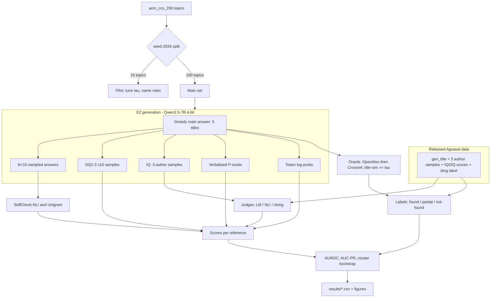

# Experiment Protocol (Prompt 07 output)

Status: **DRAFT v1. It becomes FROZEN when the student signs §10 and tags the repository `protocol-v1`.** No detector score on the main set may be computed before then. (Data-integrity checks in `06` were done before freezing; they compute label counts only, no outcomes.)

## 1. Experiments

| ID | Purpose | Data | GPU? |
|---|---|---|---|
| **V1** | Validate our SelfCheck-NLI and Unigram against published numbers | DS-2 WikiBio | Yes (NLI) |
| **V2** | Reproduce Agrawal IQ/DQ AUROC from released scores | DS-1, 6 models | No |
| **E1** | **Judge-swap ablation:** same author samples; LM judge vs. NLI judge vs. string judge | DS-1, 6 models | Yes (NLI only) |
| **E2** | New 7B generator: detectors D1–D6 on fresh references with database ground truth | DS-3 (Qwen2.5-7B) | Yes |
| **R1** | Oracle robustness: re-label DS-1 Llama-2-7B titles with OpenAlex/Crossref; agreement with Bing | DS-1 | No |

E1 is the cleanest test of the mechanism behind H1: only the judge changes. E2 tests whether the result holds for a newer model with a ground-truth oracle we control. If E2 cannot run (fallback), E1 + V1 + V2 + R1 still form a complete study.

## 2. Architecture



## 3. Input/output definitions

**Reference unit:** one title from a model's main answer to the main query for a topic.

**Label y:**
- y = 1: hallucinated. For DS-1, `bing_return == "False"`. For DS-3, no OpenAlex or Crossref candidate with normalised title similarity ≥ τ.
- y = 0: grounded.
- "Partial" (DS-3 only): best similarity in [τ − 15, τ). Excluded from the primary analysis and reported separately.

**Score s:** higher means more likely hallucinated. Every detector is oriented this way before evaluation:

| Detector | Definition | Orientation |
|---|---|---|
| D1 SelfCheck-NLI | Mean P(contradiction) of the title-line vs. each of N sampled answers | As is |
| D2 SelfCheck-Unigram | `SelfCheckNgram(n=1)` score of the title-line given the main answer and samples | As is |
| D3 Log-prob | Mean token negative log-likelihood of the title tokens in the greedy answer | As is |
| D4 Verbalised | 1 − (stated probability / 100) | Inverted |
| D5 DQ ensemble | 1 − mean(DQ1, DQ2, DQ3 "yes" fraction) | Inverted |
| D6 IQ (LM judge) | 1 − LM-judged author overlap (Agrawal prompt) | Inverted |
| J-NLI | Mean over 6 ordered pairs (i≠j) of P(contradiction \| premise = authors_i, hypothesis = authors_j); pairs involving an answer with no parseable name score 1, the same rule Agrawal's LM judge was given (D-017). J-NLI-raw (sensitivity) applies the rule only to literally empty answers | As is |
| J-STR | 1 − mean pairwise Jaccard over normalised **name-token** sets (D-017) | As is |

In E1, D6 = J-LM, taken from the released scores. Empty author samples are scored as maximally inconsistent (s = 1) and counted in the report.

## 4. Settings (E2)

| Setting | Value |
|---|---|
| Generator | `Qwen/Qwen2.5-7B-Instruct`, revision = commit hash recorded on first load, 4-bit NF4 (bitsandbytes), compute dtype fp16 |
| Prompts | Agrawal main/DQ/IQ prompts **copied verbatim** from `src/*.py`, adapted only to the Qwen chat template. Any wording change is logged as a protocol change. |
| Main answer | Greedy, max_new_tokens 400, K = 5 titles parsed by numbered-list regex (fixed on pilot) |
| Samples (D1, D2) | N = 10, temperature 1.0, top_p 1.0 |
| DQ | 10 samples each at temperature 1.0 (as Agrawal) |
| IQ | 3 author samples in independent sessions; LM judge = Qwen with Agrawal's prompt |
| D4 | Greedy, single prompt, parse an integer 0–100; unparseable → missing (counted) |
| NLI | `potsawee/deberta-v3-large-mnli`, max length 512, batch 32 |
| Oracle | OpenAlex `works?search=<title>` top 5; else Crossref `query.bibliographic` top 5; similarity = `rapidfuzz.fuzz.ratio` (order-sensitive) on lowercased, punctuation-stripped titles; τ = 90 (both set on the pilot, D-017) |
| Familiarity | OpenAlex result count for the topic's leaf phrase (after the colon), log10 |

## 5. Seeds and determinism
- Global seed 2026 (`random`, `numpy`, `torch`). Per-topic generation seed = 2026 + topic index.
- Pilot split: `random.Random(2026).sample(topics, 10)`.
- Bootstrap: 2,000 resamples of topics, seed 7.
- N-subsampling (RQ3): subsets of the 10 samples drawn with seed 11. The same subsets are used for every reference.
- GPU sampling is not bit-reproducible across hardware. **All raw generations are saved to `results/raw/*.jsonl`**, and every metric is computed from those cached files. Reproducibility is guaranteed from the cache onward.

## 6. Metrics (all: higher = better)
- **Primary:** AUROC for y = 1 per detector, with 95% cluster-bootstrap CIs.
- **Secondary:** AUC-PR for y = 1 (compare against the prevalence baseline); for V1, AUC-PR NonFact and Factual as in SelfCheckGPT.
- **Paired comparison (H1):** ΔAUROC = AUROC(J-NLI) − AUROC(J-LM) in E1, and AUROC(D1) − AUROC(D6) in E2. Paired bootstrap CI.
- **RQ2:** logistic regression y ~ log10(familiarity), topic-cluster bootstrap CI on the slope; fabrication rate per tertile.
- **R1:** Cohen's κ and confusion matrix between Bing and OpenAlex labels.
- **Audit:** κ of the automatic label vs. the manual label (n = 50).
- **Cost:** GPU-seconds per reference per detector (measured with wall-clock timers).
- No p-value claims beyond those bootstrap CIs. If 6 models × 3 judges are tested, the multiplicity is stated and claims are framed per model.

## 7. Deeper analyses (the assignment requires at least one; planned five)
1. **Ablation:** the E1 judge swap (core).
2. **Robustness:** R1 oracle swap.
3. **Sensitivity:** D1 AUROC vs. N ∈ {1, 2, 5, 10}.
4. **Error analysis:** in E2, the 20 highest-scoring false negatives and 20 lowest-scoring false positives for D1 and D6. Categorise them by hand: generic title, real title with wrong authors, echo of the topic, parse error, other.
5. **Efficiency:** cost per reference vs. AUROC.

## 8. Planned tables and figures (filled only with real outputs)
- **T1** V1: our vs. published AUC-PR (NLI, Unigram)
- **T2** V2: our vs. published IQ/DQ AUROC, 6 models
- **T3** E1: AUROC [CI] per model × judge (LM / NLI / STR), with ΔAUROC
- **T4** E2: AUROC and AUC-PR [CI] per detector D1–D6, plus cost
- **T5** R1 and audit agreement (κ)
- **F1** ROC curves, E2
- **F2** AUROC vs. model size (E1: Llama 7/13/70B and GPT) per judge
- **F3** AUROC vs. N
- **F4** Fabrication rate vs. log familiarity

## 9. Compute budget
About 4–6 T4 GPU-hours for E2 (INFERRED; replaced by the Day-3 timing test), plus under 1 h for V1 and under 3 h for E1 (6 models × NLI). Checkpoint each topic to Drive. Hard stop: if E2 timing exceeds 8 GPU-hours, reduce to 100 main topics (log as PC-xxx *before* generating).

## 10. Threats to validity
- **Construct:** "not found in a database" ≠ "fabricated" (books, grey literature, generic titles). Mitigated by the audit and the partial category.
- **Internal:** prompt sensitivity (Agrawal's stated limitation); NLI on short author strings is out of distribution for an MNLI model. J-STR is a sanity control for this.
- **External:** CS topics only; English; one new generator; 4-bit quantisation may change behaviour compared with full precision.
- **Comparability:** a different oracle and model era from Agrawal, so absolute rates are not compared, only rankings and within-dataset differences.
- **Contamination:** Qwen2.5 may have seen DS-1. Report exact title overlap with DS-1.

## 11. Pre-experiment freeze checklist
- [ ] Primary metric = AUROC (y = 1 hallucinated); primary contrasts = J-NLI vs. J-LM (E1) and D1 vs. D6 (E2)
- [ ] Pilot topics drawn and listed in `configs/pilot_topics.txt`; main = the rest
- [ ] τ and name-normalisation rules set on the pilot and written to `configs/protocol_v1.yaml`
- [ ] `neural_ans{k}` column mapping resolved from `metrics.ipynb`
- [ ] Empty-sample and unparseable-answer rules as in §3/§4
- [ ] Seeds as in §5; library versions in `requirements.txt`
- [ ] V1 and V2 completed and recorded in `baseline_validation.md` **before** E1/E2 scoring
- [ ] Repo committed and tagged `protocol-v1`
- Student sign-off: ____________ Date: ________

## 12. Logging protocol changes after the freeze
Add an entry to `research_decisions.md` under **Protocol changes**:

```
### PC-XXX | <title>
Date:
Change: (old → new)
Reason:
Were any main-set results viewed before this change? yes/no (+ which)
Affected results / reruns required:
Git commit:
```

Changes made after seeing main-set results are reported in the paper as post-hoc. Primary-metric results are always reported under the frozen v1 settings as well.
